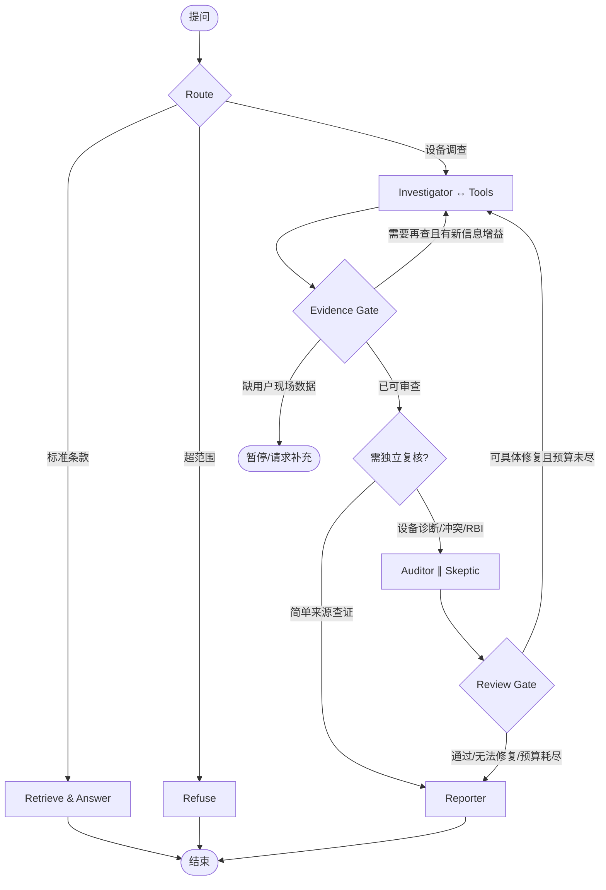

# R8 调研｜多智能体主图与执行轨迹的开源最佳实践及针对机械RBI的迁移决策
日期 2026-10-28｜状态：RESEARCH_ONLY_NOT_IMPLEMENTED｜作者：Owner独立调研
工作区 `D:\作业\竞赛\计算机设计智能体\机械智能体`
**本轮Codex正在并行修改RBI Excel与UI/附件，Owner仅写入本独立设计报告；没有改动生产Graph、backend、frontend、上游标准及老师3工具。**

## 摘要与最终选择
强烈推荐：“**LangGraph低层状态图（保持现有技术栈） + Open Deep Research 的短主图/内部Researcher循环 + CrewAI Flow的明确Gate + Magentic-One进度台账的轻量版 + OpenAI Agents SDK式Manager调专家**”。绝不把LangGraph/CrewAI/AutoGen/ADK四种不同的运行时混装。
技术架构原则：
- **外部只有4个业务阶段：Router → Investigator（内部有界工具循环）→ 按需Review（并行两个独立视角）→ Reporter**。
- 外加两个**确定性控制点**：EvidenceGate/ReviewGate（看作条件边/业务函数，不必把每个控制点做一个昂贵Agent），分支输出本轮任务状态/预算/来源。
- 简单条款查询不进入完整设备研判，无现场数据可先查标准；复杂故障原因才进入Investigator；有充分可审查的候选之后才发起审核。
- 审查不合格但“查询可修复”，回到调查阶段，附具体差缺与新查询；缺壁厚/风险矩阵输入等**只能现场提供**，调用LangGraph interrupt或输出 pending、绝不无限重试。
- 最高3个调查轮 + 最高2个审核修正回合 + 总工具≤8 + token/时间预算; 这些是**提案参数，必须A/B调优**，不是已经实现的门限。
- 不允许任何没有真人E2/E3核验的体系把来源ID返回当成设备已经安全/设备发生了确定损伤。

## A. 六个以上大社区框架与直接可读源码
|来源|具体源码与文档|真正值得复制的“模式/逻辑”|不照抄|
|---|---|---|---|
|1. LangChain/LangGraph 官方|https://github.com/langchain-ai/langgraph ; https://docs.langchain.com/oss/python/langgraph/workflows-agents ; https://github.com/langchain-ai/docs/blob/main/src/oss/langgraph/workflows-agents.mdx|ReAct环`llm_call→tool_node→llm_call`；conditional edge、Reducer、checkpointer、human interrupt；Evaluator-Optimizer的反馈重试|不需要为每个小功能都定义一个Agent|
|2. LangChain/Open Deep Research（**首选直接借鉴对象**）|https://github.com/langchain-ai/open_deep_research/blob/main/src/open_deep_research/deep_researcher.py ，尤其`clarify_with_user`、`research_supervisor`、`researcher`、`researcher_tools`、`compress_research`、`final_report_generation`；状态见`src/open_deep_research/state.py`|主图只有澄清→研究任务定义→Supervisor子图→报告；内部Researcher LLM→工具→LLM，监督器可派并行研究者且有研究轮数门槛；与“标准调查+研判报告”极相似|研究工具广泛（网页/MCP），而本项目老师对外工具严格只有3个；ResearchComplete/think_tool只作图内部信号，不能登记为老师第四工具|
|3. LangGraph supervisor/swarm|https://github.com/langchain-ai/langgraph-supervisor-py/blob/main/README.md ; https://github.com/langchain-ai/langgraph-swarm-py/blob/main/README.md|Agent作为工具/分工由Manager掌控、动态handoff、持久多轮活动角色|supervisor README官方明确对大部分用途更推荐**直接按tools实现Supervisor模式**而非新叠加库；swarm长会话易带入噪声|
|4. CrewAI Flows|https://github.com/crewAIInc/crewAI-examples/blob/main/flows/README.md ; https://github.com/crewAIInc/crewAI/blob/main/docs/v1.14.7/en/concepts/flows.mdx|@start/@router/@listen，Self Evaluation Loop，Human Feedback；业务门槛与Agent的LLM不绑定，适合纯标准、研判、审查路径|勿在LangGraph上再套一个CrewAI Flow Runtime|
|5. Microsoft AutoGen Magentic-One/SelectorGroupChat|https://microsoft.github.io/autogen/dev/_modules/autogen_ext/teams/magentic_one.html ; https://microsoft.github.io/autogen/dev/user-guide/agentchat-user-guide/selector-group-chat.html |Task Ledger（目标/待补信息）+ Progress Ledger（每轮是否改善/下一步哪个角色）+ max messages/time/token termination；专家按需动态上场|Magentic-One原本为浏览器/文件/代码开放任务，工具和成本过重；机械研判只摘取“轻量进度台账”，不用无限群聊|
|6. Microsoft Agent Framework/Semantic Kernel|https://learn.microsoft.com/en-us/agent-framework/workflows/orchestrations/ ; https://learn.microsoft.com/en-us/semantic-kernel/frameworks/agent/agent-orchestration/|Sequential/Concurrent/Handoff/GroupChat/Magentic的使用场景对照；强调审批与明确责任交接|不因是微软就整体迁.NET或追加运行时，项目已有LangGraph|
|7. OpenAI Agents SDK|https://github.com/openai/openai-agents-python ; https://developers.openai.com/api/docs/guides/agents/orchestration ; https://developers.openai.com/api/docs/guides/agents/running-agents |`agents as tools`与`handoff`的区别：本项目Manager应**保有最终回答责任**，审核员为按需工具化专家；Runner迭代模型→工具→下一轮直至终局|不把官方三个Teacher tools替换成OpenAI SDK工具层；LLM服务商不限定必须OpenAI|
|8. Google ADK|https://github.com/google/adk-docs/blob/main/docs/agents/workflow-agents/index.md ; https://github.com/google/adk-docs/blob/main/docs/runtime/event-loop.md ; https://github.com/google/adk-docs/blob/main/docs/agents/workflow-agents/parallel-agents.md |Sequential/Loop/Parallel职责清晰；Runner接收Event→应用状态变更→再次运行Agent，有很好的“状态和事件分离”学习价值|ADK文档注明新2.0 Graph/Dynamic工作流替换旧模板架构，不需因此升级/迁移本项目|
**优先源码精读路线**：OpenDeepResearch `deep_researcher.py` > LangGraph workflow `llm_call/tool_node` > CrewAI self-evaluation loop > AutoGen Magentic-One Orchestrator ledger > OpenAI SDK Agents-as-tools > Google ADK Event Loop。

## B. 精简主图：不是7-agent大串行，也不是无边界自主Swarm

- `Router`为规则为主的分类，诊断意图才要求设备材质/介质；纯标准查询不能误判为“缺现场条件”。
- `Investigator`是真Agent内部`LLM→ToolExecutor→LLM`工具循环，可本轮1至多轮；保留**恰好3个**老师工具 `damage_mechanism_query/rbi_lookup/standard_clause_search`。
- `Evidence Gate`是可解释确定性策略：来源ID存在/版本一致/可获取原文/候选/缺信息类型/本轮增益/预算；不要仅以文本相似度“通过”。
- `Review`仅必要时两分支并行，Auditor只校验引用/字段/来源链，Skeptic读取**原始观测与正式检索快照**独立找反证；分支写角色独立键，Merge按P7A一致性/保守E0合并，不能任由完成顺序决定等级。
- `Reporter`收敛候选/证据/未知/行动/限制，不引用未核风险级，也不把审核“拒绝”改成通过。
- `H`待现场测厚/设备台账是人机中断，不能靠无限检索填补；正式恢复需要Checkpoint+Command(resume) +可信授权。
- 调查第n轮`progress_ledger=`已有source sha、缺口、上次查询、是否新增可靠条款、上次审核反馈、预算和阶段，不是记录隐藏CoT。
- 运行时只能两个层面：外层业务阶段简洁、内层工具循环/并行核查可展开；每次任务不必须跑所有角色。

### 反例与验收
1. 只问“GB/T26610.3风险矩阵在哪里？”→标准查询且无设备工况，跳过设备诊断和RBI。
2. 缺material/medium的设备判断→问用户，不反复调用工具。
3. 证据支持候选、缺壁厚→只给可能机理+待测，不给设备安全保证或L1–L4。
4. Auditor判page mismatch但可查新版本→再检索一次并留下上轮错误和新原文hash。
5. Auditor与Skeptic同键结果冲突(E0/E1)→确定性E0和双hash、审阅，不first-wins。
6. 两轮查询完全相同没有信息增益→停止循环，说明信息缺失。
7. Supervisor意图标准检索但检索关键词模糊→可以先补一轮具体标准查询，不报不真实引用。
8. 总tool预算≤8、iteration≤3、review修正≤2、超时中止/保留可恢复State，无无限循环。
9. 同run并发客户端→只一次工作执行和一次assistant；旧worker失效不得追加事件（P5A已实测）。
10. 三个Teacher tools完全冻结，所有图内部状态节点/观察性事件不注册为老师新工具。
指标：真实case意图路由准确率、被拒无依据风险、citation_id/quote/printed_page/support/condition多维验收、平均tool calls、P50/P95/TTFT、token成本；需要同一真实模型和审阅Gold做公平A/B，不用P7纯本地microbenchmark推断LLM收益。

## C. “思维链”在成熟智能体中实际是什么：三层而不是一条长文本
**层1 用户可见的进展/活动流**：
- 当前阶段/轮次/调用哪个公开工具/正在检查哪个文档/结果摘要/哪个引用被验证/发现冲突/需要补什么/公开的简要理由；
- 不保证能取到模型供应商未公开的内部逐token隐藏推理，不能伪造模型用过工具或写过文件；
- 若后台无`create_file/edit_file/run_code`业务工具，UI不能出现“已修改python函数/已执行shell”等假活动。当前三Teacher tools都是只读研判工具，R8B上传只是用户提交附件而非Agent写代码。

**层2 本地**权威SQLite记录**（必须100%可恢复、项目真实数据唯一事实源）：
当前表`conversations/messages/runs/agent_events/tool_calls/evidence_refs/claims/disagreements/knowledge_documents`已存在，checkpoint单独SQLite；新追踪以`run_id`串联这些表。新增建议`trace_spans`可在真实模型功能上线时建立：
`span_id TEXT PK, trace_id(run_id), parent_span_id, conversation_id, phase, iteration, kind(workflow|agent|llm|tool|retrieval|gate|review|human|file), name, status, started_at, ended_at, duration_ms, input_digest, output_digest, model, tokens_input, tokens_output, cost_estimate, error_code, metadata_json, source_event_start_seq, source_event_end_seq`；
- 事件型`agent_events`保留严格顺序和原始事实，可重放前端；`trace_spans`由事件关联形成层级，必要时作为可重建投影而非第二个互相冲突的真相库。
- 保留`thread_id=run_id`与`checkpoint_id`链接；Checkpointer保存GraphState、业务Store保存审计及用户消息，**二者职责不同**。
- 多轮保留`attempt_id`和`tool_call_id`，同一model请求tool多次按真实调用计数；失败/重试/重复SSE回放仍有一致的event sequence；一份request对应一份span树。
- P6/P7已证明某些E0/E1命名/合并和run绑定的Bug，所以所有`canonical_clause_sha`和`page`要伴随source检验，而非自动升E2/E3。
- 明文文件、标准原文、API Key、个人数据、模型提示应按授权分层、过滤和必要长度控制；审计详情不默认对前端所有访客开放。

**层3 开发者可视化Span/Trace**：
- OpenTelemetry GenAI semconv `invoke_workflow,invoke_agent,execute_tool` ; 这些仅采集外部观察到的工作与耗时，参数/结果可能敏感、默认关闭内容采集；
- 有本地实例才能实际用：`https://github.com/Arize-ai/phoenix` 自托管可视化OTel/OpenInference、模型耗时和评测集；`https://github.com/langfuse/langfuse` 也支持OpenTelemetry/分层Trace与session成本，但部署较重；
- 为简单Web UI，`https://github.com/langchain-ai/agent-chat-ui` 的节点状态/子Agent消息和 `https://www.assistant-ui.com/docs/tools/tool-ui` 的tool loading/result/error展示比自行画全量执行图更合适；
- `https://github.com/langchain-ai/streaming-cookbook`提供typed stream、channels `messages,updates,tools,lifecycle,custom:*`和namespace/sequence思路（核对使用的本地LangGraph版本，**不能不兼容就直接换传输协议**）。
- `https://github.com/google/adk-docs/blob/main/docs/runtime/event-loop.md`明确Event→Runner应用到State→下一轮执行的循环；非常适合当前SSE事件持久化的思想。
- `https://github.com/openai/openai-agents-python` Python SDK trace agent/generation/function/guardrail/handoff/custom span，即使不用它当运行时，分类方式也适合本项目统一Span。
- 不建议本轮并行Codex UI改动中接入Phoenix或Langfuse；先设计OTel导出层，不与现有SQLite互相抢存储职责；后续真实LLM接入可单机Phoenix实验。外部云可观测性必须在隐私/标准正文授权批准后才启用，默认local only。

## D. 具体设计场景：2026-RBI调查可公开展示的证据序列
```
Run id: r-123, mode=SINGLE_LLM （未来；现有仍RULE_DEMO）
 [00.00] Router: 设备腐蚀机理研判，缺测厚
 [00.08] Investigator 迭代1: 公开依据摘要「先查询与材料及介质有关的损伤机理」
 [00.20] Tool: damage_mechanism_query(material=碳钢,medium=[氯化氢]) → 真实记录数量与返回哈希
 [00.45] Tool: standard_clause_search(keyword=...) → 来源CID/印刷页/状态
 [00.80] EvidenceGate: clause id核验E1，机理尚不能确定；缺测厚不能由工具弥补
 [00.84] Review: 仅当诊断需专业核查才并行 Auditor/Skeptic
 [01.05] Auditor: 某CID来源E1、设备适用性尚未证实
 [01.09] Skeptic: 没测厚不能声称已减薄
 [01.12] Reporter: 候选+需测厚+可追溯条款，不给风险级
```
**这个是UI数据结构示例，不是已有Run记录，所有times/IDs均为虚构格式说明。**
UI首屏先展示“检查了什么/结果/限制”，默认折叠技术Span；用户点开工具可见合法参数与授权返回；开发者可打开完整trace tree和SQLite事件。不能声称获得隐藏内部CoT。
**暂时不要**把“AI思考”当作一个能随意吐出模型私密推理内容的面板；提供`public_rationale`这一结构化字段，清楚标是“可公开决策摘要”，不是模型原始思维链。

## E. 具体实施顺序（等待R8-A/B独立Codex任务结束，不并发改后端或前端）
0. R8A Excel + R8B UI/附件任务现仍由Codex运行；Owner本轮只写本调研报告，不干预它们的文件归属。
1. **独立只读原型**：冻结现有旧Graph基线，另建`orchestration/r9_loop_candidate.py`或单独tests/样例（待Codex写权窗口释放），利用3Teacher tools的fixture +真实返回模拟`Router→Investigator loop→Gate→optional parallel reviewer→Reporter`，补10个负例。不要先接真实模型、不要切默认。
2. 接受用户API后：先老师Single LLM Harness 10真实题→100题AST/JSON解析，再将Investigator由RULE_DEMO切为有凭据的真实Agent循环；成本/安全/隐私门禁不过则fallback显示并计数。
3. 合同驱动服务端审计schema：保留现有业务SQLite/SSE权威，新增事件字段`phase,iteration,step_id,parent_step_id,public_rationale,gate_decision,retry_reason,elapsed_ms`；先运行50+事件回放回归，再加OTel spans本地Phoenix导出实验；不可把别的框架整套代码搬进来。
4. R8B UI完成后再接“每轮可见活动流”的React组件（基于assistant-ui Tool UI + 现有SSE），而不是继续拉大型前端框架。
5. 真实专业Gold评价：50条随机PDF人工核对，工具引用多维准确率，不支持风险判定率；同一LLM模型与相同工具输入对照 single_agent vs workflow vs parallel review。无Gold不声称多Agent提升质量。
6. 优先优化调用效率：缓存同一run同一工具参数与相同source hash，审查层只在有风险/矛盾/诊断结论时启动，避免“7角色全跑”及为了伪并行重复LLM成本。

## F. 仓库优先度清单（给Owner下次继续精读）
必读1 Open Deep Research: https://github.com/langchain-ai/open_deep_research/blob/main/src/open_deep_research/deep_researcher.py
必读2 LangGraph简洁tools loop: https://github.com/langchain-ai/docs/blob/main/src/oss/langgraph/workflows-agents.mdx
必读3 CrewAI Self Evaluation: https://github.com/crewAIInc/crewAI-examples/blob/main/flows/README.md
必读4 AutoGen MagenticOne Ledger: https://microsoft.github.io/autogen/dev/_modules/autogen_ext/teams/magentic_one.html
必读5 Google ADK Event Loop: https://github.com/google/adk-docs/blob/main/docs/runtime/event-loop.md
必读6 OpenAI Agents as tools: https://developers.openai.com/api/docs/guides/agents/orchestration
必读7 LangGraph Streaming cookbook: https://github.com/langchain-ai/streaming-cookbook
必读8 Arize Phoenix: https://github.com/Arize-ai/phoenix
必读9 Langfuse trace best practices: https://langfuse.com/docs/observability/best-practices
必读10 OpenTelemetry GenAI trace: https://github.com/open-telemetry/semantic-conventions-genai/blob/main/docs/gen-ai/gen-ai-agent-spans.md

研究来源公开：LangGraph、CrewAI、AutoGen、AgentFramework、OpenAI Agents SDK、Google ADK、Open Deep Research、Langfuse/Phoenix、OTel。已从各项目README/官方技术文档/具体源文件抽出模式; **本轮没有clone/fork第三方源码或运行其全部测试，亦未对四种Runtime做本机A/B实验。**
