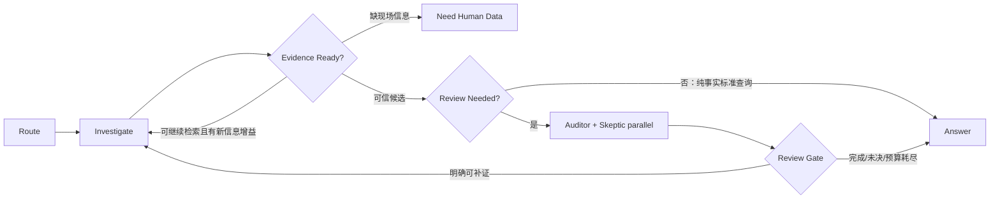

# R9 真实工业智能体对标与Phoenix/Langfuse可观测性复用设计｜2026-10-28

状态：**OWNER_RESEARCH_DESIGN_ONLY**，本轮未编辑`orchestration/`、`backend/`、`frontend/`、`upstream/`，未启动/安装Phoenix、Langfuse、真实LLM，也没有让Codex执行。R8A RBI Excel和R8B UI仍为独立Codex工作线，严格隔离。

## 一、范围：找工业设备真的用得上的系统，而不是对比框架热度
项目原问题：受限3个官方工具`damage_mechanism_query/rbi_lookup/standard_clause_search`，RBI/损伤机理/GB/T与TSG标准数据，设备材质/介质/温压/测厚/历史记录，候选机理需独立证据审核，缺损数据不能凭模型补写，更不能越过人工给设备风险L级定论。

### A. 最值得参考的具体工业仓库
|项目|源代码/说明|真实领域特征|复用建议/可信度|
|--|--|--|--|
|Intel predictive-maintenance-pipeline|https://github.com/intel/predictive-maintenance-pipeline ; https://github.com/intel/predictive-maintenance-pipeline/blob/main/docs/predictive_maintenance_pipeline.md|工业视觉缺陷→SQLite→Meta-Agent+Policy/Analysis/Evidence/Ticketing，Analysis/Evidence分别从结构化原数据核查，选择性并行；独立来源隔离、配置化prompt；Apache-2.0|**最优主图参考**：复制Meta Agent共享状态/审查相互独立思路；并不需要移植OpenVINO/YOLO/视频识别。公司维护的产业参考样例，不保证现场安全认证|
|Enterprise Agentic RAG Diagnosis|https://github.com/wyjhfl/project-a-rag-platform|设备型号+故障码+现象→混合检索→动态Query rewrite→风险/拒答/人审，带citation/trace_id、35 Playwright E2E等报告，实时工具与审计|**最优条件分流/拒绝与工程验收参考**。具体test数是项目README自述未复跑。明确缺完整证据时不判，风险策略不可原封不动搬入RBI|
|Industrial Maintenance Copilot|https://github.com/ten10do/industrial-maintenance-copilot ; repo/docs/observability.md（路径请执行者核对）|OPC UA读-only软件模拟、测量质量、异常/RAG、审批/工单、独立trace explorer，严格ML输出与LLM结论分界，设备命令要人工签审|**最优工业状态/分级权限及本地观测页面参考**。作者明确未连接真实工厂PLC、未部署生产，需按研究样例看待|
|Industrial Equipment Maintenance Agent|https://github.com/SatvikSPandey/industrial-maintenance-agent|设备ID、维修记录SQLite、RAG手册、LangGraph、工程师HITL拒绝后再诊断|适合精读`graph/`,`agents/`和`interrupt()`，但repo当前可见0 star且README clone路径与仓库名不一致，**待源码与测试复核后方可复用**|
|Industrial RAG V1|https://github.com/woddenduck/industrial-rag|Siemens PDF+型号过滤、BM25+向量+重排、证据门槛、引用`PDF/page/section/chunk`及失败回退|**最优数据层引用定位参考**；它不是多agent审核，不能把单路检索当交叉验证|
|Industrial equipment KB Agent|https://github.com/sbjsijsnn/industrial-kb-rag-agent|实际工业设备手册、故障码、维修记录，LangGraph ReAct多工具，混合召回/重排|适合只读对照3工具下的ReAct循环；不要直接转移他们公开手册的内容到老师标准库|
|Project A/RAG Assistant、ForgeIQ补充|https://github.com/Wangzihang888/industrial-rag-assistant ; https://github.com/Ameer-pasha/agentic-rag-predictive-maintenance|独立Evidence Gate/拒答、传感器与维保历史、逐轮tool trace|辅助比较；个别仓库规模较小、许可未独立核准，源代码拷贝前核许可证/测试|
注意：多个个人仓库自称production-grade，不能等同真实工业认证；Intel代码仓库Apache-2.0已核，其余均要clone后核每个LICENSE、具体commit和代码逻辑。另一制造业项目FactoryLens采用PolyForm Noncommercial，**不作为默认商用代码复制来源**。

### B. 精简主图设计（Intel工业隔离 × Enterprise证据门禁 × 工程HITL）
外层三步核心：

用户看见：调查→[必要时]独立审核→报告，Router/Gate纯确定性函数不作为LLM“专家角色”。同一问题多轮取决于数据，不要求每轮所有Agent上阵。
- 直接查询规范：Router→官方标准工具→原文/页码核查→答；无须工况，也不需要风险专项。
- 设备诊断：Investigator循环决定问什么、调哪个官方工具；输入是用户确认的工况/本轮引用/缺口，不从上一个Agent自然语言自行编造测量。
- 证据门槛：仅允许source确在run工具返回+canonical对应的source hash+字段一致；没有源就E0或人工补证。设备材料/介质、温压区间、量纲规则都是判定必要条件。
- 专业审查：Auditor独立检查ID/版本/引文；Skeptic基于原始设备观测与工具source独立反证、不能直接复述Investigator的答案。P7A同键不同payload冲突一律保守降为E0并保留双hash，绝不first-wins。
- 缺测厚等客观数据：需要用户补充/任务暂停，不得不停向三工具重复查询。普通查询可以结束为UNRESOLVED；真实人审E2/E3前须有身份认证。
- 迭代初始提案：Investigation最多3、Review修补最多2、总工具≤8、每个新循环必须出现新query/新证据/新的矛盾解决计划；无增益终止。**不是已经验证的生产参数**。
- RBI结果：原工具仍只读。安全状况等级与RBI风险L1-L4分离，无独立后果/可能性+人工条件审核不得自动给最终RBI级别。
- 不用Intel的视频流水线、个人repo的自动开设备工单，也不改官方三个固定接口。

### C. 可靠性反例作为代码验收合同
C1 纯“查GB/T标准”无材质介质→能检索；C2缺测厚→问人不反复查；C3 工况与材料适用性不符→E0/待核；C4 调查反复零增益→至多预算上限；C5 一条款同时有E1和E0→冲突E0保留双意见；C6 任何LLM输出“E3/L1且安全”→门禁不得接收；C7 人工拒绝→只有合法新证据才进入重评；C8 双客户端连接→同run唯一执行；C9 恢复晚到worker不能追加；C10 无API→明示RULE_DEMO而非假LLM交叉审查。Benchmark固定相同case/tool快照，分别比较single vs dynamic reviewer，记录实际耗时与成本。

## 二、Phoenix/Langfuse 不是Agent运行时：直接复用SDK和完整产品，不复制重写
### A. 项目现在已经有的东西
SQLite九表`conversations/messages/runs/agent_events/tool_calls/evidence_refs/knowledge_documents/claims/disagreements`，以及单独SQLite LangGraph checkpoint；FastAPI/SSE每个事件有`run_id, sequence, agent, type, payload`，P5A worker token保证一份run一个执行和正确租约。React已有独立的审查抽屉和ReactFlow；**不要另造第三套持久事件记录**。
然而这些是事件列表而非真正分层trace tree：缺子span、耗时/资源、模型tokens、跨并行节点父子关联、从chat点一键到调试界面的trace ID。

### B. 第一优先复用Phoenix OpenInference（本地开发者模式）
官方完整产品：https://github.com/Arize-ai/phoenix
SDK：https://github.com/Arize-ai/phoenix/blob/main/packages/phoenix-otel/README.md
LangGraph instrumentation：https://arize-ai.github.io/openinference/python/instrumentation/openinference-instrumentation-langchain/
1. **独立服务** 在localhost:6006启动官方Phoenix服务（通过`uvx arize-phoenix serve`或隔离venv`phoenix serve`，优先检查本机安装/Python依赖，不冲突P2冻结.venv；绝不直接公网开放本地无认证Phoenix）。不要把Phoenix React页面复制进我们的frontend，更不要把它所有Postgres等服务迁进现有SQLite。
2. **原有FastAPI工作进程接OpenTelemetry/OpenInference**：单独依赖锁与可控开关`TRACE_BACKEND=none|phoenix`; `phoenix.otel.register(endpoint='http://127.0.0.1:6006/v1/traces',project_name='mechanical-agent-local')` 和 `LangChainInstrumentor().instrument(tracer_provider=...)`（版本按官方文档核对）。`AgentGraph.state_graph.compile().invoke`可自动产生图/节点跨度，老师的三个工具通过普通Python `spec.func`调用，**需要在产品外侧为实际tool执行包一个手动OTel span**，不修改老师工具签名/返回。
3. Root`run_id`要与OTel trace ID明确映射：OTel是32hex trace_id，run UUID本身不强制照搬成OTel ID；在`runs`表迁移增`otel_trace_id`或结构化受控event`trace_link`，从会话定位开发者Trace。并行/工作线程跨上下文需显式propagate OTel context（当前FastAPI SSE启动后worker在线程执行），否则根Run和Graph spans断裂；必须E2E证明同一trace、child spans正确。
4. `tool_called`/`tool_result`是业务权威事件，自动trace只供可视化、性能和评测。trace导出失败不能让业务Run失败；HTTP BatchExporter queue bounded、应用退出flush、指标记录dropped spans。**不把工具原始PDF长文本、文件上传正文、Prompt/API Key自动采集**，默认`redacted metadata only`（source CID/页码/hash可记录，设备隐私字段摘要或hash）。
5. 客户端活动UI继续走SQLite SSE，用户点击“调试Trace”才由具有权限的本地管理员打开Phoenix项目，默认普通用户不看到开发者原始prompt/token。不要假设iframe可以安全内嵌无鉴权trace界面，采用独立新标签/本地内网反代+SSO，真实权限检查后再讨论内嵌。
6. Phoenix可原样复用Traces、Span waterfall、Datasets、Experiments、Evaluation、Playground；目前RULE_DEMO没有LLM token成本时只有节点/tool跨度，模型接入后才有genAI spans和token费用。
7. Phoenix server官方授权为**Elastic License 2.0 (ELv2)**，允许自建运行，但与OSI MIT/Apache不同；如果打算把它的Web UI复制到自己的对外商用产品或直接作为对外服务，应由Owner额外核对ELv2条款，**默认只运行原版开发工具，不拷贝改写**。

### C. 第二优先可选Langfuse（更重、暂不并装）
官方：https://github.com/langfuse/langfuse ; https://langfuse.com/docs/observability/sdk/overview ; https://langfuse.com/integrations/frameworks/langchain
- Langfuse核心源码（非EE目录）MIT许可；内置traces、spans、sessions、datasets、eval、prompts、scores，适合后期100题模型比较与用量/成本。官方LangChain`CallbackHandler`直接接graph.invoke(config={callbacks:[handler]})，不用复制整个网站。但当前官方2026文档显示Python SDK v5/JS v6，旧版本样例常以v2/v3/v4出现，**锁定与服务端版本兼容**，不要直接照旧`trace()/span()`API。
- Langfuse本地全栈并不轻量：Web/Worker + PostgreSQL + ClickHouse + Redis/Valkey + Blob/S3；当前课程项目单机没必要再维护这些基础设施。若P8模型/质量评测需要，在独立Docker Compose开发环境选其一，不改业务SQLite。Cloud版会将trace发送到第三方，当前未获允许发送标准正文/真实厂况，**默认禁止外发**。
- 强调**统一OTel接口 → 单sink切换**，正常不同时对Langfuse CallbackHandler及Phoenix LangChainInstrumentor捕获相同graph产生重复Span，若确需两平台，使用专门OTel collector并按相同Span ID多出口，测试去重和采样。

### D. 业务审计数据、用户时间线、开发者可观测三者不互相替代
```
                         Existing FastAPI + LangGraph
                                   |
                    one immutable run_id + event context
                       /                         \
       Store.append_event()                       OTel/OpenInference
              |                                         |
       SQLite WAL: strict replay                   Phoenix (dev)
              |                                         |
      React activity timeline                       trace/span tree
              |                                         |
  User audit/official clause refs                   Agent/Tool/LLM timings
              \_________ run_id <-> otel_trace_id _______/
```
不复制Phoenix的Trace存储表到我们的业务库，也不从观察系统反向生成关键业务证据。Phoenix仅用于开发者端探索trace；如果没启动Phoenix，用户依然可以依赖SQLite看到完整业务事件。
推荐最小扩展事件`phase, iteration, attempt_id, step_id, parent_step_id, public_rationale, gate_result, retry_reason, duration_ms, model_usage_redacted, trace_link`，保持`schema_version`后向兼容。更多上下文字段优先作为payload，待协议稳定再进行SQLite版本化迁移。由于Graph运行在worker子线程，检查contextvars ContextVar传播并保证跨度连通。
OTel发送的数据分类：allowlist`span.kind,agent_name,tool_name,tool_call_id,run_id,branch,outcome,duration_ms,source_digest,issue_count`；除非明确Owner授权且脱敏合规，禁止原始输入/输出字符串、设备真实标识/财务、PDF全文、上传文件、密钥。有限白名单比事后正则清理更安全。

## 三、把成熟项目原生功能放在哪里，而不重复造轮子
- 用户主聊天：保留现有React+assistant-ui的Thread、附件、会话栏，SSE时间线按phase/iteration分组，不额外集成Phoenix/ Langfuse前端组件。
- 用户点击“执行详情”：复用现有ReactFlow绘制真实阶段与循环，数据来自SQLite事件，而不是前端捏造七角色图；工具展开用assistant-ui Tool UI已经有的status/loading/success/error样式。
- 开发者点击“Tracing / 诊断性能”：新标签打开`http://127.0.0.1:6006`现成Phoenix，项目链接由后端安全产生，不能用未经查实的trace URL模板构造“点击即具体span”假跳转。先进入项目看Trace，随后按官方路由/SDK能力实现直达。
- 后期需要Prompt管理、数据集对照、100题LLM质量/成本：二选一复用Phoenix的Evals/Experiments或Langfuse平台；不同系统不要长期平行储存同一业务事实。
- 工业业务App里的开关如`TRACE_BACKEND`必须默认none，已接入可用的本机Collector才允许phoenix；失败应回退none，不能让模型输出和SQLite审计数据丢失。

## 四、工程验收门槛（以后交Codex）
1. 默认`TRACE_BACKEND=none`和旧RULE_DEMO完整回归与官方554/200保持不变；不得改上游三个工具/四个工作表。
2. 在隔离环境本地启动Phoenix；同一个run至少有`root span→investigator/graph→teacher tool span→auditor span→reporter span`，全部同OTel trace_id，span parent关系正确，Tool耗时与SQLite事件对应。未启动Phoenix时业务仍正常。
3. 双run串行/并行、旧worker租约失效、SSE重连、User A/B本地会话隔离不串trace，父子span连续；自动/手动trace不重复； 20+工具调用不超出已有官方3种。
4. 掩码负向：用模拟`API_KEY=secret`, 文本内含私人设备编号/受保护标准整页PDF，导出span必须不含这些字节（检查实际Phoenix数据库/REST结果），即使异常span也不泄漏。
5. Span计时基线比对没有Tracing vs Tracing两组P50/P95，开销不应干扰正常业务，失败exporter不能改变answer/SQLite event sequence；退出时flush与dropped计数有证据。
6. 用户UI首页不会出现原始开发者prompt/CoT，只有公示决策摘要与工具记录；高权限开发者可以从Run打开Phoenix本地Trace。所有截图应来自真Phoenix而不是静态mock。
7. 衡量动态Review是否值得启用：同样的脱敏案例、相同模型与冻结工具结果，baseline单模型 vs Agent Reviewer 两阶段，引用支持率/无根据断言率/成本/总耗时/实测错误；没有专家签核Gold不能声称提高专业准确率。

## 五、下阶段Codex文件边界
- R8-A数据窗口独占上游原Excel和相关数据审计文件；
- R8-B UI窗口独占`frontend/`与增量`backend/`上传会话接口；
- **暂不启动第三个Graph/Tracing Codex**，防止P8B修改API或UI时跨文件冲突。新任务先让Owner批准并冻结小接口合同，待R8B完成后可只改`orchestration/`及`observability/`和独立测试；后端合并时逐文件审核。
- 现项目生产仍为单轮七角色RULE_DEMO；本文的短图、Phoenix、Langfuse属于设计与调研，不能冒充已落地。

## 六、已阅读/核实的外部原始证据（2026-10-28）
Intel产业样例：https://docs.openedgeplatform.intel.com/dev/edge-ai-suites/ai-suite-metro/agentic-predictive-maintenance-pipeline/index.html
Intel Meta Agent结构：https://github.com/intel/predictive-maintenance-pipeline/blob/main/docs/predictive_maintenance_pipeline.md
Project A领域诊断：https://github.com/wyjhfl/project-a-rag-platform
Industrial Maintenance Copilot：https://github.com/ten10do/industrial-maintenance-copilot
Industrial Agent HITL：https://github.com/SatvikSPandey/industrial-maintenance-agent
Industrial RAG：https://github.com/woddenduck/industrial-rag
Phoenix README：https://github.com/Arize-ai/phoenix
Phoenix package：https://github.com/Arize-ai/phoenix/blob/main/packages/phoenix-otel/README.md
OpenInference LangChain：https://arize-ai.github.io/openinference/python/instrumentation/openinference-instrumentation-langchain/
Phoenix License：https://github.com/Arize-ai/phoenix/blob/main/docs/phoenix/self-hosting/license.mdx
Langfuse core/license：https://langfuse.com/handbook/chapters/open-source
Langfuse SDK：https://langfuse.com/docs/observability/sdk/overview
Langfuse integration：https://langfuse.com/docs/observability/get-started
Langfuse system footprint：https://langfuse.com/self-hosting

证据层级声明：本轮核读公开仓库README、部分架构文档、官方集成资料；未实际clone/benchmark所有项目源码，也未实际运行Phoenix/Langfuse。因此“设计可行”不等于“本机集成通过”。某些公共GitHub源码子页面抓取受限，应在正式借鉴前由Codex本地只读clone/打开特定代码和许可证核查，并对同样边界执行负向测试。
