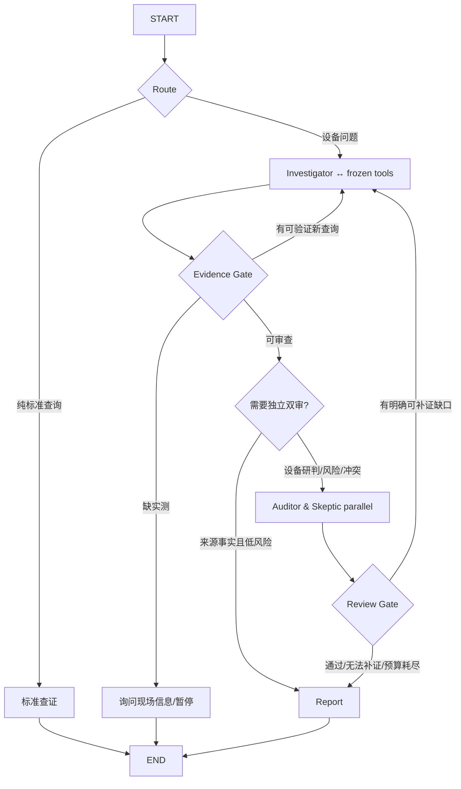

# R9-A｜工业诊断主图重构设计（2026-10-28）
状态：DESIGN_ONLY_NOT_EXECUTED。用户授权开2个新的Codex窗口；R8A正在写上游RBI Excel、R8B正在修改frontend/backend。R9A只允许新建隔离图候选和测试，不碰任何上游或正在修改的文件。

## 参考仓库和许可决策
1. `https://github.com/wyjhfl/project-a-rag-platform` 是**业务路径最接近**：设备型号/故障码/现场现象→LangGraph plan→retrieve→quality gate→answer/refuse/escalate，支持低质量检索改写，trace_id, API审计。GitHub页面当前1 star，README自述195后端+35浏览器测试未Owner复跑。GitHub页面未看到LICENSE，不应直接复制受版权保护实现代码；只读学习控制流和行为，由LangGraph官方或MIT/Apache项目提供可复用代码。
2. `https://github.com/intel/predictive-maintenance-pipeline` 4 star，Apache-2.0（其他第三方依赖各自许可证），这是PoC。Meta-Agent组织Policy/Analysis/Evidence；**Evidence主要负责理由和可追溯性，不等同独立专业Skeptic**。只迁移hub-and-spoke和schema/states思想，不能迁视频推理/Yolo/OpenVINO依赖。
3. `https://github.com/ten10do/industrial-maintenance-copilot` 1 star MIT，真实业务模拟设备数据→quality gate→RCA证据→人审→工单/trace。可参照`docs/observability.md`、安全策略与source-vs-inference区分；它的PLC是模拟，非生产认证。
4. `https://github.com/woddenduck/industrial-rag` 1 star，专长PDF页码/型号/证据决策，但未查到明确license，先只读研究，不复制代码。
5. `https://github.com/Ameer-pasha/agentic-rag-predictive-maintenance` ForgeIQ 1 star，React+FastAPI+LangGraph/Tools轻量循环，可读`graph.py,nodes.py,state.py`；需要核许可证。
6. `https://github.com/SatvikSPandey/industrial-maintenance-agent` 0 stars，工程师HITL结构参照，需核实际实现与许可证。
**排序**：业务graph首选Project A的逻辑 + Intel的职责隔离 + ten10do的真实性/审批边界；官方LangGraph负责实际执行，MIT/Apache清晰且确实相关的源码可直接复用并归档COPYRIGHT/NOTICE。小repo星级低不能冒充大厂生产质量。

## 与现有项目对照
目前`orchestration/graph.py`默认7个固定串行或跳节点顺序的RULE_DEMO；条件边不回到Investigator；没有连续工具决策循环、完全独立专业LLM、真实签署。持久化业务SQLite`runs/events/tool_calls/evidence_refs/claims/disagreements`和独立LangGraph checkpoint；P5A已有单run唯一执行和终态worker lease保护；3个教师工具及五键签名冻结，新增内部Graph node不视为第四老师工具。

## 目标方案（简单业务视图+微型子图）
主图仅三种业务角色：**Investigator 调查→按需 Review（Auditor ∥ Skeptic）→ Reporter**。两个控制函数：`route_task` 和 `evidence_gate`，不是独立收费Agent；Agent装配不同于必须调用7次LLM。

说明：上图“直接查证”也应验证源可追溯，不绕标准页码/版本检查。RBI风险仅工具有信息不足时不判L1-L4，哪怕LLM声称等级高也不自动输出；Reviewer是保守业务审查不是已授权人审。缺壁厚等只能现场产生数据，重复检索不能代替。

## 可借鉴的确切技术结构
- **State**：`run_id, immutable_context, task_kind, phase, investigate_iteration, review_round, tool_budget, tool_call_keys, citations, hypotheses, unknowns, auditor_findings, skeptic_findings, gate_decisions, output`；要使用`Annotated[..., reducer]`必须保证重复操作幂等、反序冲突E0。
- Investigator一次循环：输入**官方合法工具registry仅3个**和上一轮缺口，(1)生成public plan/待查子问题 (2)仅调相关Tool (3)记录结果hash/source (4)校验是否有新的可追溯结果；**同一args+context重复且无新证据应停止**。真实LLM provider暂采用注入式接口，默认RULE_DEMO，不虚报LLM。
- Gate：返回显式`next_action = lookup|investigate|review|ask_user|report|abstain`以及`reason_codes,missing_fields,new_evidence_count,budget_remaining`；0增益/预算耗尽退回未决输出，不无限loop。
- Reviewer：Auditor基于标准记录判ID/版本/印刷页/是否真是当轮工具回查；Skeptic基于**独立的现场观测+正式出处**二路检索反例，不只总结Investigator自然语言。并行两个分支写角色专属State，Merge保留冲突的两个payload hash，E2/E3永远不能由RULE_DEMO直接升级。
- 预算初值：investigate<=3, review_retry<=2, tools<=8，均为待调优上限。LangGraph`recursion_limit`只是额外兜底，不代替业务停止条件。
- 中文用户活动事件：`phase_started,investigation_iteration,public_rationale,tool_called/tool_result,evidence_gate,review_started/review_result/retry_reason,final`；payload额外加入`phase,iteration,step_id,parent_step_id,source_clause_ids,latency_ms`，**继续保留旧SSE envelope和sequence**。本窗口不可改backend，只在隔离图里定义/验收可转为旧EventSink的契约样例。

## R9A小步验收
1. 本次只创建独立候选`orchestration/r9_industrial_candidate.py`及`tests/test_r9a_*.py`、`evals/r9a_*.py`，不动旧`graph.py`执行路径，不碰`backend/`。
2. 至少10个工业case：纯标准查询无材质、缺测厚、低质量召回改写、同查询无信息增益、满足证据才Review、Review冲突保守E0、错页拒绝、非法LLM等级、预算耗尽、工具异常和失效worker/结果幂等。默认RULE_DEMO，真实LLM在后续基于API独立开关接入；运行中断的human审核只模拟/拒绝，不能自动签名。
3. 两种fixture路径同样可比：旧7Agent原图和候选图在相同工具快照/工况下记录工具次数、路由开销、总耗时、引用来源和审查状态，不自动声明新图更好。流程边至少有一次真实循环和至少一次双分支并行；不存在无界执行。
4. 保留原有101项中的P7A旧first-wins断言问题，不通过修改旧门禁骗绿；向Owner报告需另行更新语义不一致的测试。teacher`validate --final`554/200和老师三工具冻结；不要在新图里多注册工具。
5. 仓库源码复用证明：每个第三方来源标url/commit/文件/许可证/复制哪些函数及测试；若项目无明确license只借鉴抽象模式，不直接复制。
输出`docs/audits/R9A_GRAPH_CANDIDATE_REVIEW.md`包含真截图/轨迹/不通过原因，状态READY_FOR_OWNER_REVIEW，不部署不提交。
