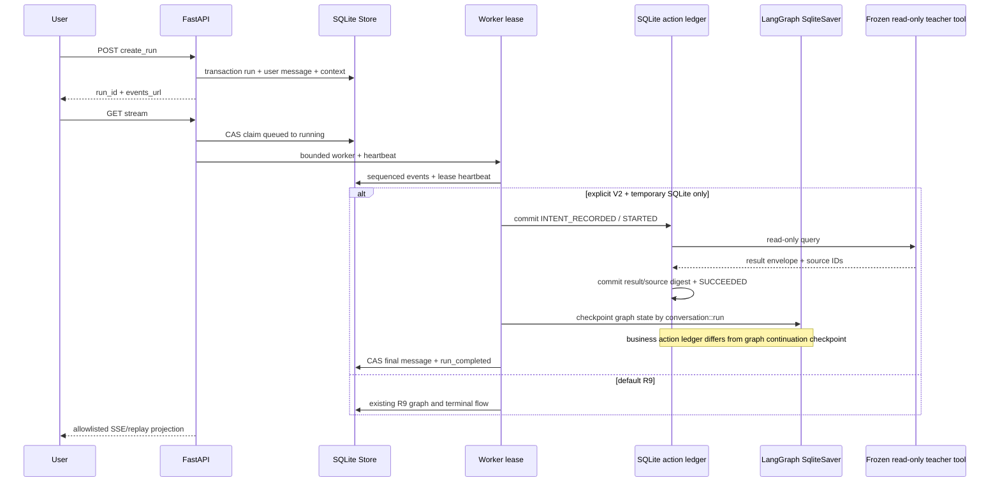

# Aetheris V2 S2.4 执行账本 / 混合 DAG 审计（2026-10-29）

**结论：PARTIAL / NO-GO。** 当前仍为临时 SQLite + Fake/Mock Provider 的本地候选。Gate 0、4 有证据；Gate 1 因硬超时取消和并发运行门禁缺证据判 PARTIAL；Gate 2 独立隔离执行/崩溃恢复测试通过，但不得越过 Gate 1 标 GO；Gate 3 服务端公开投影专项通过，Edge 双视口真实 E2E BLOCKED。AETHER_V2_AGENTIC_ENABLED 默认仍为 0，R9 为默认执行路径。没有付费模型、部署、在线服务重启、正式数据库写入、老师 upstream 修改或人审记录变更。

## 范围与保护快照

- 工作目录：D:\作业\竞赛\计算机设计智能体\机械智能体。
- 父 Git 仓库在 D:\作业\竞赛；本项目在父仓下表现为 ?? ./（嵌套未跟踪项目），不是独立主仓；未运行 add/commit/reset/clean。
- upstream 是独立仓库。执行前后状态均含既有：modified 01_RBI标准/条款摘录表_RBI.xlsx；untracked RBI_GBT26610_1_13candidates_for_review.xlsx；untracked 条款摘录表_RBI.xlsx.bak_owner_before_rbi1_20261028。这些路径未写、未覆盖、未回滚。终态 upstream diff 检查因既有 Excel dirty 返回 1；不将其状态冒称干净，也没有证据指向本轮写入。
- Owner R9/S1 修补哈希复核未变化：
  - backend/intent_router_v2.py: b5d1eb58019045068170042c0ca971db4811b7cf9cbd6944703695369b5f71dc
  - orchestration/intent.py: aca1b3b777967c26a0dda3350a4a426f094ab2dd686ccf077aa072774ca08957
  - tests/test_owner_v2_routing_regressions.py: 3077c22ef2114a518be0987e39f575963f033520d90078adf48d87649ace964d
- 所有 ledger/checkpoint 故障注入使用系统临时目录 SQLite。API 候选仍有默认关闭 Flag 与 temp path 双重门禁。

## Gate 0 — 现状、时序与回滚面

**PASS（边界与代码流确认；全并发图仍未证明）。**

真实时序：POST create_run 在 Store 事务中写入 run + user message + context；GET stream 通过 CAS claim queued→running，worker 持有 token 并 heartbeat；事件以 SQLite sequence 持久化，断线后按 after_sequence 重放；终态 assistant message + run_completed + run status 通过 lease/CAS 收口，失效 worker 无权重复发布。

默认分支仍是 R9；仅显式 V2 + temp SQLite 才加载 AgenticV2Candidate、SqliteSaver 和执行账本。LangGraph SqliteSaver 是图节点状态/continuation；v2_execution_actions、v2_subtasks 是工具动作、尝试、来源及输出的业务执行账本，二者不能相互替代。

动作写入 INTENT_RECORDED/STARTED 后才执行工具，成功响应和source digest持久提交；崩溃在外部只读调用后、账本结果提交前，会留下 UNCERTAIN，只允许有限只读重查，可能重复查询，不宣称物理 exactly-once。

实际调用与提交点时序图：

回滚：flag保持0；测试DB在临时目录可丢弃；未执行正式库 migration。没有父仓 Git 写操作。

## Gate 1 — 持久执行账本与跨进程故障注入

**PARTIAL：持久化、结果重放、UNCERTAIN、单run恢复通过；硬超时取消、并发双run仍未闭合。**

新增 backend/execution_ledger.py：稳定 run/subtask/step identity，绑定 conversation/tool/args digest；transition rows 明确记 INTENT_RECORDED、STARTED、SUCCEEDED、FAILED、UNCERTAIN；保存结果/来源摘要。args digest绑定真实参数但SQLite只保存字段名/类型manifest、不落原始keyword/工况值。子任务存 goal hash、依赖、attempt、状态、result hash、source IDs，最多2次尝试。LangGraph thread_id 复合为 conversation_id::aetheris-v2::run_id。V2 stale lease recovery 限定 temp-only；R9 recover_stale_run 不变。

实际命令：
- .venv-langgraph/Scripts/python.exe -B -m unittest tests.test_v2_s24_durable_execution -v
- .venv-langgraph/Scripts/python.exe -B -m unittest tests.test_v2_s24_mixed_dag.MixedDAGTests.test_25_independent_process_mixed_dag_recovers_after_tool_result_commit -v

真实观测：
- 已提交工具结果后 worker 子进程 os._exit(77)；新解释器恢复同 run；工具调用数 1→1，最终 assistant 消息 1。
- 工具 side effect 后、结果提交前 os._exit(78)；重启留下 UNCERTAIN，允许只读重查；调用数累计 2，attempt_count=2，assistant 消息 1。
- 单独 tool ledger 在 STARTED→UNCERTAIN→STARTED→SUCCEEDED 后累计调用数2；不冒称 exactly-once。
- mixed DAG 工具结果提交后、subtask terminal commit 前 os._exit(89)；恢复后重放账本结果，工具调用数1→1，终态消息1。
- Stable action identity复用不同args digest被拒；同run跨conversation重放被拒（test_same_run_action_cannot_be_replayed_across_conversations）；不同run_id隔离。SQLite args_json仅含参数名/类型，不含原始keyword。Stale V2 lease在临时库requeue，再claim新token。
- 首轮暴露 checkpoint 自定义 checkpoint_ns 导致 LangGraph “Subgraph ... not found”，修复为移除自定义namespace，使用run级复合thread_id；专项通过。
- strict RouteDecision snapshot通过 Python dict校验时报 ValidationError；改用 JSON 严格schema重校验。
- 第一次 mixed API 工具事件未传 Store 所需 tool key，触发 backend/store.py:582 KeyError；修复冻结事件字段与脱敏 args/result 后 E2E 通过。

未闭合：AgenticV2Candidate._invoke 使用 FutureTimeout 只能停止等待，future.cancel()/shutdown(wait=False) 不能终止已运行线程；当前仅软超时，底层线程可能继续。没有实现可杀进程/可取消 adapter。也未用真实 barrier-driven 双run进程验证同/异 CID 并发 lease、两条 SSE replay竞态。故 Gate1 不标PASS。

## Gate 2 — MIXED 串行DAG

**隔离验证通过；整合候选可运行，但 GO 被 Gate1 阻断。**

新增 orchestration/mixed_dag.py：
- MIXED 最多4个子任务，校验依赖/未知边/环；拓扑排序后确定性优先工程安全任务。
- GENERAL_EXPLANATION 走无网络 MockTextProvider；STANDARD_LOOKUP 调冻结标准工具并写动作账本；工程子任务进入候选 Agentic Graph；WRITING_SYNTHESIS 仅消费成功依赖，不添加现场断言/风险等级；CLARIFICATION_REQUIRED 为DEFERRED；失败不生成风险等级并阻断依赖项。
- 每个子任务持久化状态/attempt/来源。Failed/uncertain最多2次。
- 标准工具source必须符合canonical clause身份；无source成功、坏source、外部伪造source不会进入引用。Risk level固定null。
- API显式MIXED branch接入DAG，R9仍默认走原实现。

命令：
- .venv-langgraph/Scripts/python.exe -B -m unittest tests.test_v2_s24_mixed_dag -v → 25 tests OK。覆盖只翻译不诊断、第四工具、缺来源、超时、风险等级夹断、拒绝教师自由文本确诊、子进程中断恢复。
- .venv-langgraph/Scripts/python.exe -B -m unittest tests.test_v2_s2_integration.S2ApiIntegrationTests.test_explicit_mixed_route_runs_sqlite_dag_and_public_tool_projection -v → PASS。额外覆盖上下文跨conversation action重放拒绝：tests.test_v2_s24_durable_execution.DurableExecutionLedgerTests.test_same_run_action_cannot_be_replayed_across_conversations → PASS。
- 临时API端到端实际标准工具调用1、source C-1、attempt1、assistant终态1；子进程kill恢复见Gate1。

## Gate 3 — Trace与证据可核查性

**服务端投影代码/专项测试通过；Edge E2E BLOCKED。**

- backend/api.py 的事件replay与SSE使用同一服务端allowlist projection，不再把SQLite原始event帧直接返回。公开层保留sequence、阶段、状态、subtask ID/依赖、冻结工具名、attempt、来源条款定位；keyword/material/medium/工况值被占位，只保留参数存在情况；忽略任意tool/model payload、prompt、文件路径、来源摘录和assistant prose。
- frontend/src/trace-events/model.ts 为subtask started/completed/skipped添加公开摘要映射，继续投影来源与脱敏参数；未增加可任意切换的Owner debug入口。
- 没有真实用户认证/ACL/TLS。当前loopback开发版投影不能替代身份隔离；正式上线仍需Owner批准认证、租户ACL、安全传输与restricted evidence权限设计。
- Edge 1440×900与390×844截图、console/network检查BLOCKED：Desktop Commander唯一设备Offline（last seen 1101h），无可用Browser/Playwright工具面。本轮没有启动在线服务或伪造截图；Vitest/TS/Vite不等于视觉验收。

## Gate 4 — 回归与文档一致性

**工程回归PASS（全单测模块分组覆盖）；规定的单命令runner未在DevSpace请求时限内完成，按工具超时报告。**

scripts/test_s2.py 及 --unit-only 各一次在DevSpace MCP约120秒请求窗口超时，没有成功退出码或最终summary，不记为该脚本PASS。随后将38个unittest模块按三组不重叠运行，覆盖相同unittest发现范围：

1. .venv-langgraph/Scripts/python.exe -B -m unittest tests.test_deepseek_adapter tests.test_engineering_semantics tests.test_import_guard tests.test_lexical tests.test_owner_v2_routing_regressions tests.test_p11_usage_stats tests.test_p12_context_flow tests.test_p12_model_profiles tests.test_p13_local_load tests.test_p13_model_reliability tests.test_p13_router_hypotheses tests.test_p13_search_service tests.test_p14_pipeline_artifacts → 77 tests, OK。
2. .venv-langgraph/Scripts/python.exe -B -m unittest tests.test_p15_a_rbi_field_repair tests.test_p15_b_mechanisms tests.test_p15_c_field_audit tests.test_p15_c_retrieval_eval tests.test_p16_b_fidelity_retrieval tests.test_p16_c_human50_gate tests.test_p3b_evidence_audit tests.test_p4a_api_safety tests.test_p4b_claim_verifier tests.test_p5a_lease_event_integrity tests.test_p6a_parallel_evidence tests.test_p7a_merge_consistency → 99 tests, OK。
3. .venv-langgraph/Scripts/python.exe -B -m unittest tests.test_api_vertical_slice tests.test_r10_casual_chat tests.test_r8b_upload tests.test_r9a_industrial_candidate tests.test_r9b_observability tests.test_runtime tests.test_store_and_graph tests.test_v2a_router_gateway tests.test_v2b_agentic_graph tests.test_v2c_conversation_memory tests.test_v2_s2_integration tests.test_v2_s24_durable_execution tests.test_v2_s24_mixed_dag → 139 tests, OK (3 optional skips)。
汇总：315 discovered；312 PASS、3 optional SKIP、0 FAIL、0 ERROR。

其他真实命令/结果：
- .venv-langgraph/Scripts/python.exe -B scripts/test_s2.py --pytest-only → P16-A pytest 5/5 PASS。
- 命令：.venv-langgraph/Scripts/python.exe -B -c "from evals.r10_offline_chat_matrix import run_matrix; rows=run_matrix(); print(len(rows), all(r['trace_replay_consistent'] for r in rows))" → R10矩阵20 runs，10 RULE_DEMO + 10 Mock DEEPSEEK，trace replay一致20/20。llm_failure/DEEPSEEK是矩阵预期failed场景且无assistant输出；全程无真实模型；既有r10_offline_chat_matrix_s2_20261029.jsonl没有覆盖。
- .venv-langgraph/Scripts/python.exe -B -m unittest tests.test_r10_casual_chat -v → 4/4 PASS。
- .venv-langgraph/Scripts/python.exe -B -m unittest tests.test_owner_v2_routing_regressions tests.test_r9a_industrial_candidate -v → 23/23 PASS。
- upstream/04_接口文档/validate.py --final → clauses 554/554、trajectories 200/200、multi-step144、特殊三类各15，PASS。
- upstream/05_提交区/_selftest_tools.py → 17/17 PASS。
- frontend：Vitest 17 files / 118 tests PASS；TypeScript tsc -b --pretty false PASS；Vite build 3124 modules PASS。产物含614.49 kB JS chunk warning。
- npm test launcher首次失败：内部node命令未解析（'node' is not recognized）；随后用已安装Node绝对路径直调Vitest/tsc/Vite完成等价验证。

## 修改清单

- backend/execution_ledger.py 新增：临时SQLite动作/子任务账本、摘要、状态和有界只读重试。
- backend/store.py：V2 stale lease恢复；R9逻辑保持。
- orchestration/agentic_v2.py：durable ledger接入、checkpoint按run隔离与恢复。
- orchestration/mixed_dag.py 新增：≤4项串行DAG、依赖/来源/Mock/失败门禁。
- backend/api.py：显式MIXED候选接线、服务端公开事件投影、flag/temp path门禁保持。
- frontend/src/trace-events/model.ts：子任务Trace摘要。
- tests/test_v2_s24_durable_execution.py 与 tests/test_v2_s24_mixed_dag.py：独立进程、崩溃、恢复与混合场景。
- tests/test_v2_s2_integration.py、tests/test_api_vertical_slice.py：MIXED API E2E与服务端脱敏回归。

## 未过项与恢复方案

1. Gate1硬超时取消：给冻结只读工具建可取消进程adapter，测试kill/reap/账本收敛；此前保留软超时，但Gate1不GO。
2. Gate1并发：barrier-driven进程测试同/异CID并发run与双SSE replay，核事件顺序、工具调用数、lease和单终态。
3. Gate3 Edge：待Owner恢复Desktop Commander，按桌面与390×844视口跑Edge截图、console/network与公开事件核查。
4. 对外部署前补身份/租户ACL/TLS及restricted evidence访问策略；当前trace投影不是认证机制。
5. 数据真实性门禁未改变：教师结构/工具通过不代表PDF人工核验、DM82适用性、真人50证据或原生LLM解析100项通过。

## 下一阶段 Owner 决策建议

- 只批准Gate1剩余隔离工程：评估并实现可取消的只读工具边界，并补真实并发lease/SSE故障证据；不打开正式V2。
- 若接受软超时而非强制取消，明确记录为产品限制，但保留Gate1 PARTIAL。
- Desktop Commander恢复后独立完成Edge E2E。
- Gate1/3剩项经过Owner复审前，状态固定S2_4_PARTIAL / V2_DEFAULT_NO_GO。
